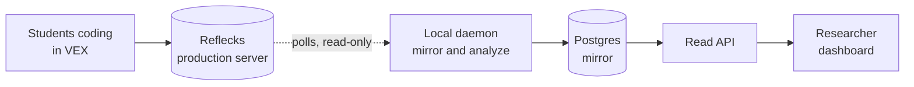

# Learner Modeling Dashboard

The Learner Modeling Dashboard is a live "who needs help" board for a room of students who code in
VEX. The dashboard does these tasks:

- It copies the activity of the students from the Reflecks production backend to your own machine.
- It measures how much the code of each student changes between runs. The measure is a plain edit
  distance, with no black-box model.
- It divides the session into episodes.
- It shows on one screen who needs attention now (wheel-spinning, resilience, inactive, explorer,
  step-by-step).

The dashboard only reads from production.



> The full documentation is at <https://inviteinstitute.github.io/lm-dashboard/>.
> To read it locally on port 4000, run `mkdocs serve`.

## Quick Start

You need only **Docker**: Docker Desktop on Mac or Windows, or Docker and the compose plugin on
Linux. One compose file runs the whole stack, the same on your laptop and in prod. The stack has
these parts:

- Postgres
- The API, which serves the built dashboard
- The ingestion daemon

```bash
cp .env.example .env.mirror   # fill in PROD_USERNAME / PROD_PASSWORD
echo "POSTGRES_PASSWORD=$(python3 -c 'import secrets;print(secrets.token_hex(16))')" > .env
make dev                      # or: docker compose up -d
```

`make` (or `make help`) lists the shared commands: `dev`, `test`, `lint`, `format`, `build` and
`deploy`. See the [Development](https://inviteinstitute.github.io/lm-dashboard/guides/development/)
docs.

1. Open the dashboard.
2. Sign in with `PROD_USERNAME` and `PROD_PASSWORD`.
3. Add a student ID.

The data for that student starts to arrive while the board is open.

The [Quickstart](https://inviteinstitute.github.io/lm-dashboard/quickstart/) docs have the full
setup: dev and prod, configuration, and accounts.

## What You Get

- A card for each student. The card has a **run track**, an **episode** sparkline, a status badge
  from the active triggers of the student, and **Present** and **Picked** toggles. The run track has
  one tile for each run. The color of a tile shows how many blocks changed since the last run.
- A live **"who needs help"** column. Five edit-distance triggers (wheel-spinning, resilience,
  inactive, explorer, step-by-step) drive this column. You can write **notes** on each alert. Click
  a learner to see the full detail and notes log.
- A top bar. Use it to pause and resume polling, to **export** all data as a zip of CSV snapshots,
  and to reset the board.

## Serving It Remotely

Run the prod stack (`docker compose -f compose.yml up -d`). The API binds to `127.0.0.1:8000`, so
nginx or another reverse proxy sits in front of it. **HTTP Basic** (the native login dialog of your
browser) gates the whole origin and checks against the researcher table. Thus nothing is ever
exposed without the gate. While the app is served, a dead-man's switch pauses the production polling
of a board when its dashboard is not open.

## Under the Hood

The daemon is the only process that writes. The API and dashboard only read a Postgres store. You
can rebuild this store from the raw event log at any time. The full documentation covers
configuration, the API and the architecture. It is at
<https://inviteinstitute.github.io/lm-dashboard/>.
