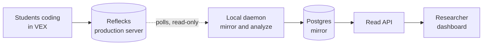

# Learner Modeling Dashboard

The Learner Modeling Dashboard is a live "who needs help" board for a room of students who code in
VEX. It does four things:

- It copies the students' activity from the Reflecks production backend to your own machine.
- It measures how much each student's code changes between runs, as a plain edit distance with no
  black-box model.
- It divides each session into episodes of coding, running and resetting.
- It shows on one screen who needs attention now (wheel-spinning, resilience, inactive, explorer,
  step-by-step).

The dashboard only ever reads from production. It can also listen to a ZANY study's logs instead of
Reflecks, for the research team.



> The full documentation is at <https://inviteinstitute.github.io/lm-dashboard/>.
> To read it locally on port 4000, run `mkdocs serve`.

## Quick Start

You need only **Docker**: Docker Desktop on Mac or Windows, or Docker and the compose plugin on
Linux. One compose file runs the whole stack (Postgres, the API that also serves the dashboard, and
the ingestion daemon), the same on your laptop and in prod.

```bash
cp .env.example .env.mirror   # fill in the secrets it lists
echo "POSTGRES_PASSWORD=$(python3 -c 'import secrets;print(secrets.token_hex(16))')" > .env
make dev                      # or: docker compose up
```

Then open the dashboard and track a student ID. The first time, the browser passes a Cloudflare
Turnstile check, which keeps bots off the API and is remembered for 12 hours. There is no login.
Each browser gets its own board, and a student's activity starts to arrive while their board is
open.

`make` (or `make help`) lists the shared commands: `dev`, `test`, `lint`, `format`, `build` and
`deploy`. The [Quickstart](https://inviteinstitute.github.io/lm-dashboard/quickstart/) has the full
setup, and [Development](https://inviteinstitute.github.io/lm-dashboard/guides/development/) has the
day-to-day workflow.

## What You Get

- A card for each tracked student, with their last few runs (each tile coloured by how much the code
  changed), their episodes, a status from their active triggers, and **Present** and **Picked**
  toggles.
- A live **Needs Intervention** column, fed by the five triggers. You can pick a student or write a
  note right on an alert.
- A student sheet with every run and episode, the latest program, goal evidence for Castle Crashers
  runs, the student's trigger history and your notes.
- A top bar to pause and resume polling, turn trigger types on and off, **export** the board as a
  zip of CSV snapshots, and reset the board for a new session.

## Serving It

Run the prod stack (`docker compose -f compose.yml up -d`). The API binds to `127.0.0.1:8000`, so
nginx or another reverse proxy sits in front of it and handles TLS. Turnstile gates every `/api/`
call. A dead-man's switch pauses a board's production polling when no one has its dashboard open.

## Under the Hood

The daemon is the only process that writes the student mirror. The API serves what the daemon
worked out and stores the researchers' own inputs (roster, notes, picks), and the mirror can be
rebuilt from the raw event log at any time. The full documentation covers configuration, the API and
the architecture.
