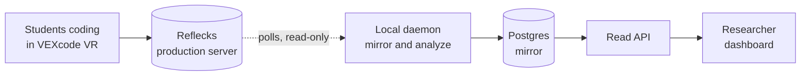

# Learner Modeling Dashboard

The Learner Modeling Dashboard is a live board for a room of students who code in VEXcode VR. It
shows a researcher who is stuck, who is idle and who is trying big changes, while it happens.

It copies the students' activity from the Reflecks production server to your own machine, and it
only ever reads from production. For each student it counts how many blocks change between one run
and the next, as a plain edit distance with no model behind it. It splits each session into
episodes of coding, running and resetting. Five rules over those numbers raise alerts called
triggers (wheel-spinning, resilience, inactive, explorer and step-by-step), and the board shows them
in one live column.

A board can also listen to a ZANY study's logs instead of Reflecks, for the research team.



The full documentation is at <https://docs.inviteai.org/lm-dashboard/>, beside the ZANY and ATLAS
docs. Run `zensical serve` to preview it locally on port 4000.

## Quick Start

You only need Docker. On macOS and Windows that is Docker Desktop, and on Linux it is Docker with
the compose plugin. One compose file runs the whole stack (Postgres, the API that also serves the
dashboard, and the ingestion daemon), the same on your laptop and on the server.

```bash
git clone --recurse-submodules https://github.com/InviteInstitute/lm-dashboard
cd lm-dashboard
cp .env.example .env.mirror   # fill in the secrets it lists
echo "POSTGRES_PASSWORD=$(python3 -c 'import secrets;print(secrets.token_hex(16))')" > .env
make dev                      # the same as: docker compose up
```

Open [http://localhost:3000](http://localhost:3000) and track a student ID. The first time, the
browser passes a Cloudflare Turnstile check, which keeps bots off the API and lasts 12 hours. There
is no login. Each browser gets its own board, and a student's activity starts to arrive while their
board is open.

`make help` lists the shared commands, which are `dev`, `test`, `lint`, `format`, `build` and
`deploy`. The [Quickstart](https://docs.inviteai.org/lm-dashboard/quickstart/) has the full
setup, and [Development](https://docs.inviteai.org/lm-dashboard/guides/development/) has the
day-to-day workflow.

## What You Get

- A card for each tracked student shows their last ten runs, each tile colored by how much the code
  changed, their episodes, a status from their active alerts, and **Present** and **Picked**
  toggles.
- A live **Needs Intervention** column lists the alerts, and you can mark a student picked or write
  a note right on an alert.
- A student sheet shows every run and episode, the latest program, goal evidence for Castle
  Crashers runs, the student's alert history and your notes.
- The header can pause and resume polling, turn trigger types on and off, export the board as a zip
  of CSV files and reset the board for a new session.

## Serving It

On a server, run only the base compose file (`docker compose -f compose.yml up -d`). The API listens
on `127.0.0.1:8000`, so nginx or another reverse proxy sits in front of it for TLS. Turnstile gates
every `/api/` call, and a dead-man's switch stops a board's production polling when nobody has its
dashboard open. On the INVITE server, a push to `main` deploys through `scripts/deploy.sh`.

## Under The Hood

The daemon is the only process that writes student data. The API serves what the daemon worked out
and stores the researchers' own inputs (roster, notes and picks), and the derived data can be
rebuilt from the raw event log at any time. The docs cover the configuration, the API and the
architecture, and a CI job keeps them in step with the code.
