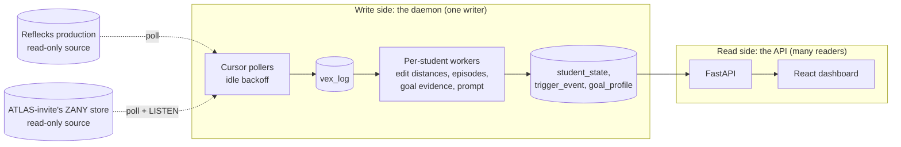

# Architecture

The dashboard copies student activity from a production backend onto one machine, analyzes it
there and serves it to researchers. It only reads from production. It pulls events over the
production REST API and never writes back.

The whole stack is one `docker compose up`. That is Postgres, the API and the daemon, with no
message broker and no cloud services. Each browser works on its own board, and the daemon serves
every board from one shared copy of the students' data.

## The Three Services

| Service | Command | What it does |
|---|---|---|
| `daemon` | `python -m app.pipeline` | the only writer of student data, one blocking loop that serves every board |
| `api` | `uvicorn app.main:app` | serves the dashboard and its data, plus small per-board writes like notes and picks |
| `db` | `postgres:18` | where the two meet. Postgres lets the one writer and many readers work at once |

The split is on purpose. The daemon is a long-running loop, and there must be exactly one of it,
because the ingest cursor assumes a single writer. The API stays light and safe to restart on its
own. It runs no analysis, and it reads only what the daemon already worked out.

Both services run from one Docker image. The first build stage builds the React app, and the API
serves it at `/` so the dashboard and `/api` share one origin.

## How Work Flows

The daemon works in ticks. Each tick takes the events that arrived since the last one, which is
usually a handful from the last 0.5 to 5 seconds, stores them and moves its cursor forward. So it
sits between batch and streaming processing.

Inside a tick, events are stored one at a time, but the analysis waits until the end. A student
who sent six events in one tick is recomputed once. The [write path](write-path.md) page has the
tick in full.

The design is a simple form of CQRS. `vex_log` is an append-only log of every event, and each row
has a unique source ID. `student_state` and the tables beside it are built from that log, and
nothing else writes them. So the derived tables are a cache. Drop them, replay the log, and you get
the same state back.

## How Fresh The Data Is

The board is never far behind what students do.

- The derived state is at most one daemon tick behind the event log.
- The dashboard is at most a quarter second behind the derived state, because the API checks for
  changes four times a second and pushes them over the live stream. If the stream is down, the
  dashboard polls every 1.5 seconds instead.

End to end, that is one daemon tick plus a quarter second, which no person in the room will notice.

The processes coordinate through Postgres alone. A board's reset is an API write that hides older
activity on that board and leaves the shared data alone, so the daemon has nothing to do for it.

## Access And Boards

There is no login. Cloudflare Turnstile keeps bots off `/api/`, and it doesn't identify people. A
browser solves the widget once and gets a signed cookie for 12 hours.

Each browser keeps a board ID in its local storage and sends it with every request in the
`X-Board-Id` header. The API scopes every read and write to that board. A request without a board
ID uses one shared default board.

ZANY's study logs need more than that. A board set to a ZANY study answers nothing until its
browser unlocks ZANY with the research login. [Sources](sources.md) covers how that works.

## The Look

The dashboard uses IBM Carbon (`@carbon/react`) in INVITE's theme, the same one ATLAS-invite's
research pages use. `frontend/src/styles/carbon.scss` builds only the Carbon components the
dashboard uses, and `_invite-theme.scss` puts INVITE's colors on Carbon's g10 (light) and g100
(dark) themes.

Carbon draws every control it has a component for. That covers the header and its panel, buttons,
tags, toggles, fields, toasts, the reset dialog, the program listing, the notes and trigger lists,
the goal table and the accordions. The run track, the episode strip, the rung ladders and the pips
are the dashboard's own, drawn with Carbon's tokens through the `--lmd-*` names in
`styles/base.css`.

## When Things Fail

| What fails | What happens |
|---|---|
| The daemon crashes in the middle of a drain | on restart it reads the overlap window again and drops the duplicates, so nothing is lost |
| Production is down or answers 5xx | the daemon backs off up to 30 seconds and logs `UNHEALTHY` after five failures in a row, then carries on when production is back |
| ZANY's store is down | that tick's ZANY drain fails with a warning and Reflecks carries on |
| The daemon restarts | each student's state is rebuilt from `vex_log`, and the cursor was already saved |
| The daemon hits an error it doesn't expect | it logs it and exits, and Docker restarts it with the error in the log |
| Two daemons run at once | the cursor races, which is the one thing that breaks. Run exactly one |
| A researcher's click can't be saved | the dashboard retries, then keeps the input in the outbox and shows a red toast |

## Growing It

Postgres and per-board isolation already carry this from one class to a whole program's boards.
The first thing to give out at a larger scale is the daemon's one-student-at-a-time analysis, and
the inactive check that reads every student each tick. Memory isn't the limit, since each worker
keeps at most 5,000 events.

If it ever needs to grow, these are the steps, in the order they would be needed.

1.  Have production push events (a webhook, Redis Streams or NATS) so the daemon subscribes
    instead of polling. That removes polling delay and idle load.
2.  Move the analysis to a task queue such as Celery or RQ, but only if each run gets expensive,
    like an LLM call per run.
3.  Scope the live stream to each board, since today any change wakes every board, and run more
    than one API worker.

None of these change how the derived state is built. Keeping the write side and the read side
apart is what makes that true.
