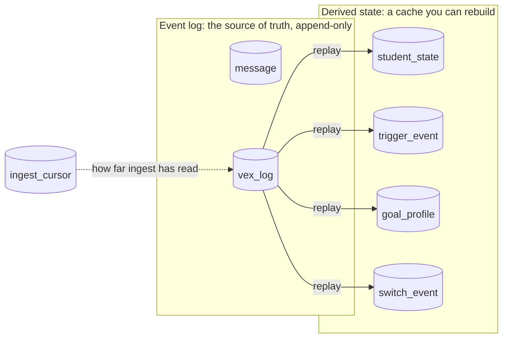

# Data Model

Everything lives in Postgres. All the SQL is in `app/db.py` (psycopg 3, no ORM), so the whole query
surface is in one file. Queries use `?` placeholders, and one helper turns them into psycopg's
`%s`. Timestamps are stored as fixed-width text (see below), and flags are `smallint` 0 or 1.

## Tables

| Group | Tables | What they hold |
|---|---|---|
| Event log | `message`, `vex_log` | every raw event, append-only, each with a unique `source_event_id` (Reflecks) or `zany_seq` (ZANY). Shared |
| Cursors | `ingest_cursor` | how far each source has been read, one row for Reflecks (`vex_poll`) and one for ZANY (`zany`). Shared |
| Derived state | `student_state`, `trigger_event`, `goal_profile`, `switch_event` | what the daemon works out, one set per student. Shared |
| Boards | `workspace` | one row per browser, found by the board ID it sends |
| Roster | `tracked_student` | a board's students with its presence and picked flags, unique on `(workspace_id, studentID)` |
| Researcher input | `note`, `pick_event`, `trigger_ack`, `outbox` | a board's notes, its pick history, the alerts it dismissed, and inputs that failed to save |
| Board settings | `workspace_setting` | per-board keys, which are `source`, `polling_enabled`, `disabled_triggers`, `viewer_last_seen` and `reset_at` |
| Shared settings | `meta` | the daemon's current session (`session_start`), and the trigger switches from before they were per board |
| Change counters | `channel_rev` | one counter per live-stream channel |

!!! tip
    The derived tables are a cache of the event log. Drop them, replay `vex_log`, and they come back
    the same. A board's [reset](../guides/using-the-dashboard.md#reset) doesn't touch them. It only
    hides what came before it on that board.

## Tables The Log Can't Rebuild

`note` and `pick_event` hold the researchers' own observations. A reset writes them to a CSV backup
before it clears them.

`outbox` keeps a researcher's input word for word when its write failed every retry. Nothing else
holds a copy, so a reset leaves it alone and the export includes it. See
[saving a researcher's input](read-path.md#saving-a-researchers-input).

`channel_rev` holds four counter rows, one per dashboard channel. A Postgres trigger function,
`bump_rev()`, bumps the right one on every write to a source table and sends a `NOTIFY`. The live
stream reads these counters instead of scanning tables. They are derived too, so losing them is
harmless, since the next write sets them again.

## Shared Or Per Board

The raw events and everything worked out from them belong to the student, so every board shares
them. A student that two researchers watch is pulled from production and analyzed once.

What belongs to a board is the researcher's layer on top. That is which students the board
tracks, its notes and picks, the alerts it dismissed and its settings. Dismissals live in
`trigger_ack`, because the shared `trigger_event` row can't hold one board's dismissal. (The row's
own `acknowledged` flag is still set, since the inactive re-alert reads it.)

Removing a student from a board deletes their shared data only once no board tracks them.

## One Student, Any Casing

A VEX handle is unique only within a class, and it sometimes arrives in a different casing (`cobra3`
or `Cobra3`). `db.canon_id` lowercases every key the derived tables use, so those are one student.
`student_state.display_id` keeps the newest raw casing for the screen. `switch_event` records when a
tracked handle changes casing or shows up under a new class code, and that feeds the
identity-switch toasts.

ZANY students are keyed `zany:<study>:<participant ID>`, so they never collide with a Reflecks ID.

## Two Rules In db.py

??? note "Timestamps"
    Timestamps are stored as UTC text in the fixed-width format `%Y-%m-%d %H:%M:%S.%f`. Because
    every value has the same width, comparing the strings is the same as comparing the times, so
    SQL like `ORDER BY started_at` and `resolved_at >= cutoff` works on the stored text. Two
    helpers, `dt_to_db` and `db_to_dt`, are the only place this conversion happens.

??? note "JSON"
    `runs`, `episodes`, `detail` and `profile` are JSON stored as text, read and written through
    two helpers. Where SQL needs to look inside one, it casts to `jsonb`, as the momentary
    trigger's duplicate check does with `detail::jsonb->>'run_index'`.

## Why Postgres

| Reason | What it buys |
|---|---|
| Many boards write at once | researchers add notes and picks at the same time, and Postgres handles that where SQLite's single writer lock would queue them |
| Real tenancy | foreign keys and unique keys like `(workspace_id, studentID)` keep boards apart |
| `LISTEN` and `NOTIFY` | the change counters notify, and the daemon listens for ATLAS's deletions in ZANY's store |
| Still one command | it is one more container in the same compose stack |

All the SQL stays behind `app/db.py`, which is why the move off SQLite was a rewrite of one file.
