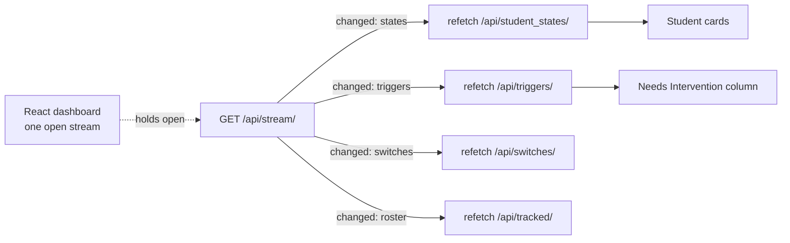

# Read Path And Dashboard

The read side is thin on purpose. It hands back what the daemon already worked out and runs no
analysis of its own.

## The API

The API is a FastAPI app (`uvicorn app.main:app`) in `app/main.py`. It reads the derived tables
and shapes them for the dashboard. It also creates the schema when it loads, so a fresh clone works
whichever process starts first.

Its writes are small and always scoped to the caller's board. It adds or removes a tracked
student, dismisses an alert or an identity switch, adds a note, sets presence or picked, resets the
board, pauses or resumes its polling, switches its trigger types and its source, and parks a
failed input in the outbox. The [API reference](../reference/api.md) lists every endpoint.

Every read applies the board's view. It shows only the students on the board's roster, only those
from the board's source (Reflecks or one ZANY study), only activity since the board's last reset,
and only the trigger types the board shows.

## The Live Stream

The dashboard holds one Server-Sent Events stream, `GET /api/stream/`, and the server pushes when
something changes.

Four times a second, the server reads one sum of the `channel_rev` counters. That read is tiny and
doesn't grow with the data. When the sum moves, the server reads the four counters, works out which
channels changed (`states`, `triggers`, `switches` or `roster`) and sends a `changed` event naming
them. The dashboard refetches only those endpoints. So an idle board costs one quiet connection,
and a change reaches the screen in about a quarter second.

An open student sheet fetches that one student's heavier payload, with the program, the LLM prompt
and the goal evidence, and fetches it again whenever the `states` channel changes. That keeps the
card grid's own payload light.

!!! note "Polling takes over when the stream is down"
    If the browser has no `EventSource`, or the stream drops, the dashboard polls each endpoint
    every 1.5 seconds until the stream reconnects on its own. A hidden tab closes the stream and
    stops the timers. That matters for the daemon, because the open stream is also how it knows
    someone is watching (see [the dead-man's switch](../guides/configuration.md#the-dead-mans-switch)).

!!! tip "Responses are gzipped"
    The API gzips any response over about 1 KB, and the run arrays and the prompt shrink about
    tenfold. The stream is sent with `Content-Encoding: identity`, so gzip never holds an event
    back in its buffer.

## Why It Is Fast

The dashboard reads small, indexed rows that were computed before anyone asked. It still queries
Postgres on every request, but each query is cheap and limited to the board's roster. The
in-memory workers make the daemon fast, not the dashboard.

## What A Student Row Holds

Each student in `GET /api/student_states/` carries their derived state.

| Field | What it holds |
|---|---|
| `studentID` | the lowercase key the student is stored under |
| `display` | the ID in its newest casing, or a ZANY participant's typed ID |
| `classCode` | the class code from the newest event |
| `run_count`, `event_count` | how many runs and events since the board's reset |
| `last_seen` | the time of the newest event |
| `runs` | `{runs: [{index, edit_distance, ts, playground}], run_count}`, the run track that every trigger reads |
| `episodes` | the episodes and pauses, with their counts |
| `updated_at` | when the daemon last wrote this row |

The single-student endpoint adds `block` (the LLM prompt, its time and a readable program) and
the goal evidence. A student's headline status isn't stored. The dashboard works it out from the
[triggers feed](../reference/api.md#get-apitriggers) it already has.

## Saving A Researcher's Input

Everything on the board can be rebuilt from the event log except what researchers enter. Presence,
picks, notes, dismissals and roster changes have no other source, so they get the most care. Every
one of them goes through `useSafeWrite` in the dashboard.

1.  The dashboard shows the change at once.
2.  If the write fails, it tries twice more with a short wait.
3.  If it still fails, it parks the input in the `outbox` table through
    [`POST /api/outbox/`](../reference/api.md#post-apioutbox) and shows a red "Not saved" toast
    that names the action. If the API itself is down, it parks the input in the browser's local
    storage and sends it on when the stream reconnects.

So an input is never lost without a word. Reset leaves the outbox alone, the export includes it,
and [`GET /api/outbox/`](../reference/api.md#get-apioutbox) lists what is parked.

[Using the dashboard](../guides/using-the-dashboard.md) shows how all of this looks on screen.
