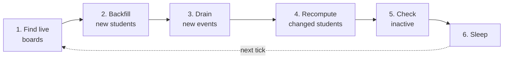
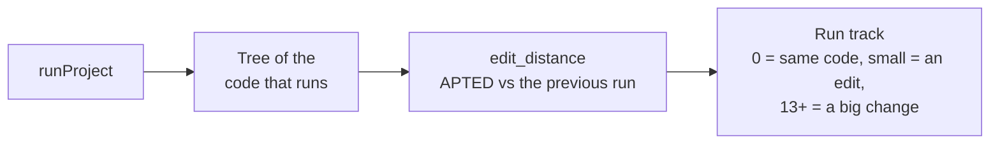
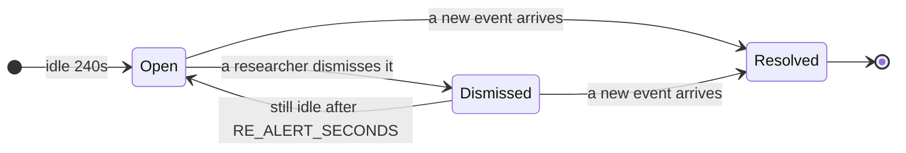

# Write Path (The Daemon)

The daemon (`python -m app.pipeline`) is the only process that writes student data. It is one
blocking loop, and each pass through it runs the whole pipeline for every board at once.

## A Tick

1.  The daemon finds the live boards. A board is live when its polling is on and, with the
    dead-man's switch armed, someone has looked at it in the last 90 seconds. If no board is live,
    it waits a second and checks again.
2.  It keeps a worker for every student on any board's roster. A student who was just added to a
    live board gets a one-time backfill of their history since the daemon started.
3.  It drains everything new from production (and from ZANY's store, when that is connected) for
    the students on live boards, and stores it.
4.  It recomputes each student who got new events in this tick, once each.
5.  It checks every student for the inactive trigger.
6.  It sleeps until the next tick, longer when nothing is happening.

A reset has no step here. Reset is an API action that records when the board was reset, and the
API hides anything older on that board. It never touches the shared data, so the daemon doesn't
need to know.

## Sessions

Each start of the daemon is a new session. It ingests only events from the moment it started, for
both the backfill and the live drain, and it rebuilds every tracked student's card from those
events. So a student ID that a class reuses on a later day doesn't pull in its earlier sessions.
The older rows stay in `vex_log`.

Run numbers start again at 0 each session. Stored goal evidence and the duplicate check for alerts
are keyed by session as well as run number, so a restart never overwrites an earlier session's runs
or silences an alert on a reused run number.

## Polling Production

The client signs in with a token, reuses one keep-alive connection and signs in again when a
request comes back 401. It has two kinds of backoff, and they do different jobs.

The idle backoff keeps load off production. While events flow, the daemon polls every 0.5
seconds. When a tick finds nothing, the wait doubles each time up to `PIPELINE_IDLE_MAX` (5
seconds), and the first new event brings it straight back to 0.5.

The failure backoff handles errors. When a request fails, the wait grows up to 30 seconds, and
after five failures in a row the daemon logs `UNHEALTHY`.

!!! tip
    Poll load follows how much is happening, not how many students are on the roster. A quiet
    class barely touches production, however big it is.

## The Cursor And Duplicates

This is what makes a restart lose nothing.

The cursor is a timestamp (`last_event_time`) and the highest source ID seen. Each drain asks
production for events from 2 seconds before the cursor, so an event that shares a timestamp with
the last one isn't skipped.

Production pages newest first. The daemon collects every page, sorts the events oldest first, and
only then stores them and hands them to the workers. A worker must see a student's events in the
order they happened, because a run's outcome follows the run and run numbers count up.

The daemon stores first and moves the cursor second. The cursor only moves after a whole drain is
written. Every event has a unique `source_event_id`, so an event fetched twice is dropped, first by
a lookup and then by a `UNIQUE` constraint if two writes race.

So a crash in the middle of a drain costs nothing. On restart the daemon fetches the overlap
again and drops what it already has. At-least-once delivery plus the duplicate check means each
event counts exactly once.

## Rosters And Backfill

The daemon only stores and analyzes students on some board's roster. It takes the union of every
board's roster, so a student on two boards is polled and analyzed once. It only polls production
for students on a live board, so a paused or closed board's own students cost nothing. A student
on two boards stays live while either board is.

Adding a student starts a backfill of their history since the session began, separate from the
cursor, so their card fills in within a tick or two. The backfill runs once per student, then the
daemon rebuilds the student's worker from the log in time order. Turning a board's polling back on
marks its students for backfill again, which fills the gap from the pause.

## Per-Student Workers

Each tracked student gets a `StudentWorker` that keeps their last 5,000 events in memory.

A worker recomputes once per tick no matter how many events arrived, because a `dirty` flag marks
it for the end of the tick. If a worker is missing, after a restart for example, it reloads its
events from `vex_log`. That is the one SQL read on the hot path. It also reloads the run numbers
each trigger already fired on, so a restart never repeats an old alert.

Workers are keyed on the student ID in lowercase, so `cobra3` and `Cobra3` are one student. On
every event the worker compares the incoming casing and class code with the last ones it saw, and
records any change in `switch_event`. Those records feed the identity-switch toasts. The worker
keeps the newest casing as `display_id` for the dashboard.

Clocks on two devices can disagree. When `cobra3` and `Cobra3` feed one worker from two machines, the
last event to arrive isn't always the last to happen (one pair was about four minutes apart). So a
worker only takes a new program snapshot when its time is not older than the one it holds. A
snapshot without a time is always taken, since there is nothing to compare.

## Measuring Each Run

There is no machine-learning model. Each run gets one number, its edit distance from the run
before it. The engine is the `learner_models` package in the
[agent-lm-packages](https://github.com/InviteInstitute/agent-lm-packages) submodule under
`vendor/`, and the worker feeds it one event at a time through `RunDistanceStream`.

For each `runProject` event, the engine parses the code that runs into a tree. That is every stack
under an enabled hat block, the My Blocks those stacks call, and the numbers and text typed into
each block. Detached blocks, disabled blocks and comments are left out. Then it computes the APTED
tree edit distance from the previous run's tree. Adding, deleting, changing or moving a block each
costs 1, so the number reads as "how many blocks changed."

The first run has nothing to compare with, so its `edit_distance` is `null`. After that, `0` means
the code that runs is the same, a small number is an edit and a large one is a rewrite. A program
over 600 blocks also gets `null`, because APTED is roughly cubic and real programs stay under 200
blocks. The engine's README and `test_scoring_policy.py` list every kind of edit and its cost.

Each tick also splits the session into episodes with the engine's `SessionSegmenter`, and renders
the student's current blocks as a compact prompt for an LLM. Episodes are CODE, RUN and RESET
stretches. A gap of 5 minutes or more between events becomes an inactive pause, and a wait of 5
seconds to 5 minutes after a run becomes a post-run pause.

For Castle Crashers runs, the worker also feeds every event to the `goal_strategy` engine, which
profiles what goal each run shows evidence for. The worker stores one `goal_profile` row per
profiled run, and the student sheet shows them as goal evidence.

!!! note "Every write bumps a change counter"
    A Postgres trigger in the schema bumps a counter in `channel_rev` on every write to
    `student_state`, `goal_profile`, `trigger_event`, `switch_event` or `tracked_student`, and
    sends a `NOTIFY`. The daemon doesn't know about it. That counter is how the live stream answers
    "did anything change?" with one tiny read (see the [read path](read-path.md#the-live-stream)).

## Triggers

Four triggers read the run's edit distances and one reads time. Their history is in
`trigger_event`.

The four momentary triggers (wheel-spinning, resilience, explorer and step-by-step) fire from the
worker as soon as a run lands. Each one is stored once per run, keyed by run number and session.

Inactive is the one sustained trigger. The per-tick sweep opens it when a student has been idle
for `INACTIVE_TRIGGER_SECONDS`, keeps it fresh while they stay idle, and resolves it when a new
event arrives.

| Trigger | Kind | Fires when |
|---|---|---|
| Wheel-spinning | momentary | `WHEEL_SPIN_ZERO_RUNS` (6) runs in a row with `edit_distance == 0`, then stays quiet until a real edit |
| Resilience | momentary | a real edit (`edit_distance > 0`) right after `RESILIENCE_ZERO_RUNS` (4) or more zeros |
| Explorer | momentary | one run with `edit_distance >= EXPLORER_EDIT_DISTANCE` (13) |
| Step-by-Step | momentary | the count of runs with `edit_distance >= 1` reaches the playground's threshold (6 by default). A zero-edit run starts the count again |
| Inactive | sustained | no event for `INACTIVE_TRIGGER_SECONDS` (240 seconds) |

The numbers live in the engine's `learner_models/constants.py`. `app/constants.py` imports them
from there, so the dashboard can't drift from the engine.

!!! note "Each playground is measured on its own"
    A student can switch playgrounds during a session, and comparing code for one challenge with
    code for another means nothing. So the runs are split into stretches on the same playground.
    The first run after a switch gets a `null` edit distance, and the four momentary triggers count
    only within the current stretch. Step-by-Step takes its threshold from `ITERATIVE_THRESHOLDS`,
    which is 6 for Castle Crashers Plus, 5 for Coral Reef Rescue and 3 for Rover Rescue, and 6 for
    any playground not listed.

!!! note "Wheel-spinning and Resilience read one streak"
    On the runs `0 0 0 0 0 0 1`, wheel-spinning fires on the sixth zero, because the student is
    re-running the same code. Resilience fires on the `1`, because they finally changed it. Both
    are stored. When a student has several active alerts, the card's headline is the first in
    `TRIGGER_PRIORITY` (`frontend/src/constants.js`).

### Inactive Comes Back

Dismissing the inactive alert doesn't silence it for good. If the student is still idle
`RE_ALERT_SECONDS` (10 minutes) after the alert started, the sweep closes that alert and opens a
new one. A student who never comes back keeps showing up in the feed.
