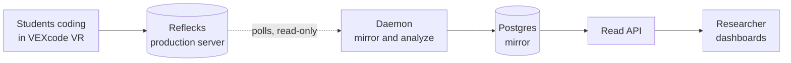
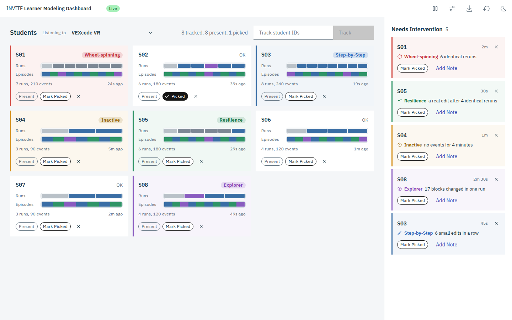

# Learner Modeling Dashboard

The Learner Modeling Dashboard is a live board for a room of students who code in VEXcode VR. It
shows a researcher who is stuck, who is idle and who is trying big changes, while it happens, and
it keeps a record of the session for later research.

## How It Works

Students code in VEXcode VR, and their logs go to the Reflecks production server. A daemon asks
that server for new events every half second or so and copies them into a local Postgres
database. For each student it tracks, the daemon works out three things.

- How many blocks changed between one run of the code and the next, as a plain tree edit distance.
- The episodes of the session, which are stretches of coding, running and resetting with the pauses
  between them.
- Five alerts, called triggers, that fire on simple rules over those numbers.

A small API serves the results to a React dashboard over a live stream, so a change shows up on
screen about a quarter of a second after the daemon writes it. Nothing ever goes back to
production. The dashboard only reads.

There is no login. Each browser gets its own board, with its own roster, notes, interview picks
and settings. A Cloudflare Turnstile check keeps bots off the API. All the boards share one copy of
each student's data, so a student that two researchers watch is still pulled from production only
once.

A board can also listen to a ZANY study instead of Reflecks. ZANY's logs come from ATLAS-invite,
and the research login unlocks them.

## The Five Triggers

| Trigger | Fires when |
|---|---|
| Wheel-spinning | a student re-runs the same code six times in a row |
| Resilience | a student makes a real edit after four or more identical re-runs |
| Inactive | a student sends no events for four minutes |
| Explorer | one run changes 13 or more blocks |
| Step-by-Step | a student makes a steady run of small edits (six on most playgrounds) |

They are five fixed rules over what a student did. The researcher decides what an alert means.

## Where To Go Next

-   :material-rocket-launch:{ .lg .middle } **[Quickstart](quickstart.md)**

    ---

    Get the whole stack running on your machine with one command.

-   :material-monitor:{ .lg .middle } **[Using The Dashboard](guides/using-the-dashboard.md)**

    ---

    Cards, the alert column, the student sheet, export and reset.

-   :material-sitemap:{ .lg .middle } **[Architecture](concepts/architecture.md)**

    ---

    How the daemon, the API and Postgres fit together, and why.

-   :material-code-tags:{ .lg .middle } **[API Reference](reference/api.md)**

    ---

    Every endpoint, with its request and response.

